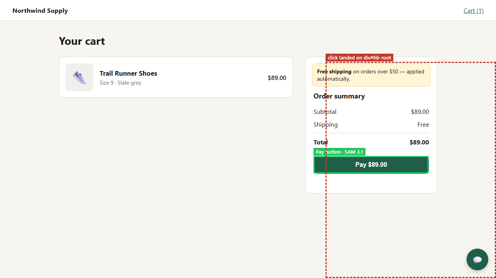
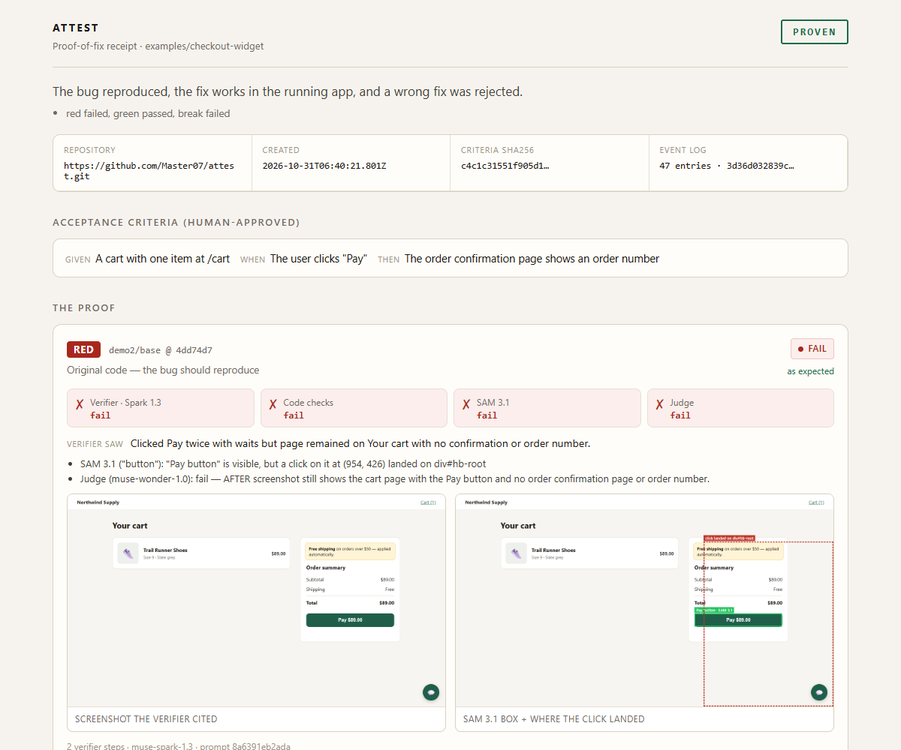

# Attest — proof-of-fix for AI pull requests

A verifier that never sees the code reproduces the bug, confirms the fix in the running app, shows it would reject a wrong fix, and seals it all into a receipt anyone can check.

*Built entirely during the Meta Global AI Developer Hackathon (Oct 26 – Nov 4, 2026) · Indie track · Push the Frontier.* <sub>Design docs were written Oct 26–30; git was set up on Oct 31, so the first commit contains them.</sub>



<sub>A real run ([receipt](proofs/pr-1-live/)). The wrong fix's test passed — it checks the CSS, not the click; Attest drove the app and found why paying still fails: SAM 3.1 locates the Pay button (green), but the click lands on an invisible 440×560 container from a third-party chat widget (red).</sub>

## The problem

AI agents now write pull requests faster than anyone can review them, and a green test suite isn't proof: even from a detailed specification, frontier agents' tests catch **fewer than 55% of logical mutants** (TestSuiteBench, Oct 2026 — [summary by a co-author](https://x.com/nielstron/status/2109651666790445209)). UI bugs are worse: a test without a browser can check the code, not what the user sees, so in CI a fix that works and a fix that doesn't look the same.

The reviewer's real question — *does this actually fix the bug?* — still means pulling the branch, starting the app and clicking through it. That is the step that gets skipped.

**Attest does that step and leaves evidence either way.** If the fix works, the reviewer gets a proof instead of a manual QA session; if it doesn't, they get the screenshot of where the click actually landed. Who wrote the fix doesn't matter — a coding agent, a person, or Muse Code in Attest's own loop.

<sub>Honest note: in our runs Muse Code fixed every demo bug on the first try. The wrong fixes Attest rejects below are ones we wrote, so that the Break phase has something to catch.</sub>

## What Attest does

A person approves one plain-language requirement (*given a cart, when the user clicks Pay, then the order confirmation shows an order number*). Attest then runs three experiments on the **running app**:

| Phase | Build | Must show |
|---|---|---|
| **Red** | Original code | The bug really happens |
| **Green** | The fix | It now works |
| **Break** | A wrong fix | Attest rejects it — otherwise its "yes" means nothing |

Each phase gets **four independent votes**, and disagreement is never a pass:

1. **Muse Spark 1.3** drives a real browser with computer use. It is **blind**: it never sees the code, diff or the producing agent's reasoning.
2. **Code checks** — the final URL and network calls, no AI involved.
3. **SAM 3.1** — is the element visible, and did the click actually reach it?
4. **A Muse Spark Open judge** (open weights, on Baseten) — sees only the requirement and the screenshots in order — no actions, no code.

Everything — votes, screenshots, a hash-chained event log — is sealed into a **signed receipt** plus an evidence page. `attest verify` checks it without calling any model, and rejects any edit. Every result below is a committed receipt: `npm run verify-proofs` checks all of them ([proofs/](proofs/)).



## Results

**On an AI agent's real, merged fix in someone else's app:** [shizukutanaka/Board#921](https://github.com/shizukutanaka/Board/pull/921) (MIT), written by **Devin**, fixed "Enter on a focused toolbar button also stamps a shape". With the criterion frozen before any run, Attest reproduced the bug on the PR's parent, showed Devin's fix removes it, and rejected a half-fix (Space only, **written by us** and committed before the run) — **PROVEN**, live, the verifier and the open-weights judge agreeing in every phase, neither seeing the code ([receipt](proofs/realworld/board-921-run2/) · [write-up](examples/realworld/board-enter/README.md)). An earlier run without a wrong fix gave the honest PROVEN_UNCHECKED ([receipt](proofs/realworld/board-921-run1/)).

**As a pull-request comment:** on our own demo PR [Master07/attest#1](https://github.com/Master07/attest/pull/1), Attest proved the fix live, rejected a wrong fix, and posted the proof as a comment ([receipt](proofs/pr-1-live/)).

On a [benchmark of 10 planted UI bugs](docs/BENCHMARK.md), each with a plausible wrong fix ([receipts](proofs/benchmark/)):

- **Every wrong fix passed its tests:** 6 with behavioural unit tests; the 4 visual bugs (covered, off-screen or invisible button) with the CSS or HTML check you can write without a browser — which is exactly why such a check passes while the button stays covered.
- **8 / 10** real fixes **PROVEN**; the other 2 INCONCLUSIVE (one Meta API outage, one disagreement between voters).
- **0** wrong fixes certified as working. **0** real fixes rejected.
- When one verifier run scrolled its way to a pass on a wrong fix, the independent judge disagreed and Attest refused to certify it ([B04 receipt](proofs/benchmark/run-2/B04/)).

Ten planted bugs show the mechanism works; they are not a measure of real-world accuracy.

**A real bug, too:** Attest proved TodoMVC's real 2012 fix for "deleting a todo takes two clicks" — in a project we didn't write — after four honestly reported runs: an ambiguous requirement and two blind spots in Attest (a retry hiding the bug, a judge that saw only the final frame) surfaced and were fixed, and no run certified the wrong fix. [Every run →](examples/realworld/todomvc-delete/README.md) · [signed receipt (release download)](examples/realworld/todomvc-delete/README.md#check-the-receipt)

## Try it — no API key needed

Requires Node 22+ and git; step 2 also needs Microsoft Edge or Chrome (`ATTEST_BROWSER_CHANNEL=chrome` for Chrome).

**1. Check the proofs — seconds, no key, no model calls.** Every result above is a signed receipt from a **live** run, committed in [proofs/](proofs/) (TodoMVC's, at 101 MB, is a release download). This checks each signature, hash chain, screenshot and video, and recomputes each verdict from the recorded votes:

```bash
git clone https://github.com/Master07/attest.git && cd attest
npm install
npm run verify-proofs
start proofs/realworld/board-921-run1/index.html            # one evidence page (macOS: open)
```

**2. Re-run a proof yourself — about 2 minutes, from a cassette.** The app, browser, clicks, code checks and receipt are real; the model answers come from a **cassette recorded in a live run**, so no key is needed. The receipt and evidence page are marked as a replay.

```bash
git branch demo2/base origin/demo2/base; git branch demo2/bad-fix origin/demo2/bad-fix; git branch demo2/fix origin/demo2/fix
npm run attest -- prove --app examples/checkout-widget --base demo2/base --pr demo2/fix --break demo2/bad-fix --replay examples/checkout-widget/cassette.jsonl
npm run attest -- verify evidence/run-<id>/receipt.json
```

Optional: `npx playwright install ffmpeg` (a few MB) adds a screen recording of every phase to the evidence page; without it, everything else still runs.

**3. Live, with your own keys:** `cp .env.example .env`, set `MODEL_API_KEY` (and `BASETEN_API_KEY` for the open-weights judge; without it the judge uses Muse Wonder), and drop `--replay …`.
**Let Muse Code write the fix**, then prove it: `npm run attest -- loop --app examples/checkout-widget --base demo2/base --break demo2/bad-fix --report "I click Pay and nothing happens."`
**Start from a recorded bug report**: `npm run attest -- draft --video examples/checkout-widget/bug-report/bug.webm --audio examples/checkout-widget/bug-report/narration.wav --out my-draft.yml` drafts criteria from a screen recording and narration for you to review ([sample](examples/checkout-widget/bug-report/README.md)).

### Prove a pull request

With `gh` authenticated, run the proof on a PR's base and head and write a GitHub-Markdown comment:

```bash
npm run attest -- pr 42 --app examples/checkout-widget --break demo2/bad-fix
npm run attest -- comment evidence/run-<id>/receipt.json
```

`attest pr` fetches `attest/pr-42/{base,head}`, runs Red / Green / Break (live, or with `--replay`), verifies the receipt, and writes `pr-comment.md` beside it. Add `--post` to publish it with `gh pr comment`.

## Built on Meta's models

| Model | Role in Attest |
|---|---|
| **Muse Spark 1.3** | The blind verifier — Responses API `computer` tool driving the browser — and, with video input, drafts criteria from a bug recording |
| **Muse Voice Transcribe** | Transcribes the user's spoken bug report for `attest draft` |
| **SAM 3.1** | Locates on-screen elements; combined with click hit-testing to show what really received a click |
| **Muse Spark Open** (open weights, via Baseten) | Independent judge from the screenshot sequence (no actions or code); falls back to **Muse Wonder** without a Baseten key. [Provenance](docs/MODEL_STRATEGY.md#open-weights-provenance) |
| **Muse Code** | Writes fixes headlessly in `attest loop`; Attest proves or rejects them |

Every model Attest calls at runtime is a Meta model. Details: [MODEL_STRATEGY](docs/MODEL_STRATEGY.md).

**Open-weights provenance:** Muse Spark Open runs from the maintainer's own Baseten account. Its use is on record, not just claimed: each live receipt names the judge (`judge: baseten/meta-models/muse-spark-open`) and keeps its verbatim vote and reason per phase — see [Board#921 run 2](proofs/realworld/board-921-run2/), [Board run 1](proofs/realworld/board-921-run1/) and [PR #1](proofs/pr-1-live/) — and the committed cassettes (`examples/checkout-demo/`, `examples/checkout-widget/`, `examples/realworld/board-enter/`) hold its recorded responses.

## Documentation

| Doc | What it covers |
|---|---|
| [ARCHITECTURE](docs/ARCHITECTURE.md) | The proof, the blind verifier, vote combining, the receipt, threats and limits |
| [BENCHMARK](docs/BENCHMARK.md) | Ten planted bugs, two runs, what the numbers do and don't mean |
| [Real-world proof](examples/realworld/todomvc-delete/README.md) | A real 2012 TodoMVC bug and its real fix |
| [MODEL_STRATEGY](docs/MODEL_STRATEGY.md) | Which Meta model does what, and why |
| [ROADMAP](docs/ROADMAP.md) | Built / shown / planned |
| [Decision records](docs/adr/) | Including [ADR 0005](docs/adr/0005-narrow-to-proof-of-fix.md): why Attest is proof-of-fix, not an orchestrator |

## Development

```bash
npm run typecheck                    # tsc --noEmit
npm test                             # unit tests, no network
npm run smoke                        # boots the demo branches, raw-mouse clicks Pay
npm run bench -- check               # AI-free check of the 10 benchmark scenarios
```

| Module | Role |
|---|---|
| `src/proof.ts` | Runs Red / Green / Break, collects votes, seals the receipt |
| `src/cua.ts`, `src/prompt.ts` | The blind computer-use verifier (with stateless-replay fallback) |
| `src/checks.ts`, `src/sam.ts`, `src/judge.ts` | Code checks, SAM 3.1 visibility, the independent judge |
| `src/verdict.ts` | Pure vote and verdict logic |
| `src/eventlog.ts`, `src/receipt.ts`, `src/report.ts` | Hash-chained log, signed receipt + `verify`, evidence page |
| `src/workspace.ts`, `src/browser.ts` | A git worktree per ref; Playwright with raw mouse/keyboard and click hit-testing |
| `src/producer.ts`, `src/loop.ts` | Muse Code headless producer and the closed loop |
| `src/api.ts` | Responses API client with retries and record/replay |

## Limits

- The bug must reproduce in an app Attest can start locally; production-only bugs are out of scope.
- "Not reproduced" is not "fake": Attest refuses to certify, it doesn't rule on the report.
- The verifier is a model and can be inconsistent; the four votes reduce false passes, they don't eliminate them.
- **Break needs a wrong fix you supply.** On someone else's PR, without one the strongest honest verdict is `PROVEN_UNCHECKED` (the fix works; Attest's ability to reject a wrong one wasn't tested). Generating wrong fixes automatically is roadmap.
- Only fix mode is built; regression and equivalence modes are designed, not implemented.
- If a voter can't vote — say the judge's endpoint is down — it abstains (`n/a`, with the error recorded in the receipt) and the remaining votes decide; disagreement is still never a pass.
- The receipt proves nothing changed after capture, not that the capture environment was honest. The signature detects a later edit; it is made with a key created on the machine that ran the proof.
- The app under test never sees Attest's API keys, but it does run as your user — run unfamiliar repos in a VM or container.

More in [ARCHITECTURE §12–13](docs/ARCHITECTURE.md).

## How it was built

One developer, during the hackathon, with AI coding agents: **Claude Code** and **Command Code** wrote much of the code under the developer's design and review, and commits they co-wrote carry `Co-authored-by` trailers. Their work was checked the way Attest checks any agent's work — against written acceptance criteria, with tests and independent validation, misses recorded. At runtime, every model Attest calls is a Meta model.

## Open-source dependencies

| Package | Use | License |
|---|---|---|
| [`playwright`](https://www.npmjs.com/package/playwright) | Browser driver | Apache-2.0 |
| [`yaml`](https://www.npmjs.com/package/yaml) | Config and criteria parsing | ISC |
| [`typescript`](https://www.npmjs.com/package/typescript) | Compiler (dev) | Apache-2.0 |
| [`tsx`](https://www.npmjs.com/package/tsx) | TypeScript runner (dev) | MIT |
| [`@types/node`](https://www.npmjs.com/package/@types/node) | Node type definitions (dev) | MIT |

Muse Code is driven through its CLI (`muse exec`); no SDK dependency.

## License

MIT — see [LICENSE](LICENSE).
