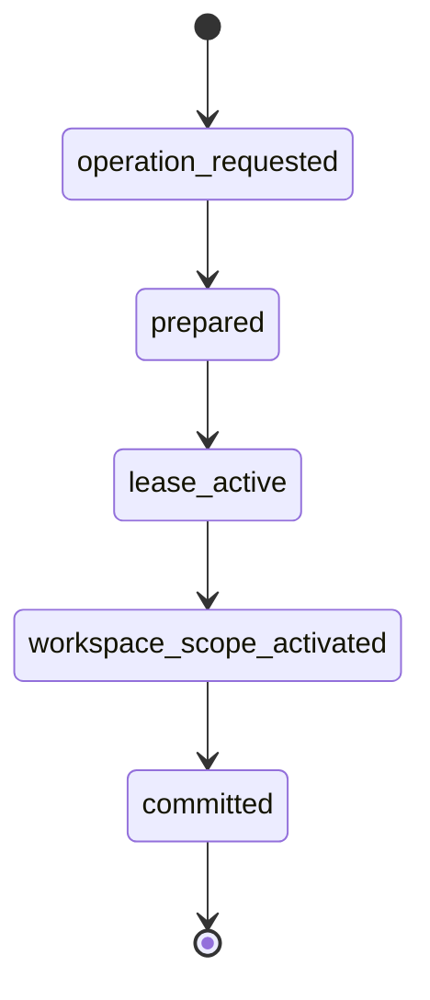

# Agent Design

> **Audience:** devs · **Status:** draft · **Last updated:** 2026-10-27 · **Related:** [ARCHITECTURE](ARCHITECTURE.md) · [MODEL_STRATEGY](MODEL_STRATEGY.md) · [EVENT_LOG_AND_REPLAY](EVENT_LOG_AND_REPLAY.md)

> **Superseded for the hackathon build** by [ADR 0005](adr/0005-narrow-to-proof-of-fix.md) and the new [ARCHITECTURE](ARCHITECTURE.md). This doc describes the earlier orchestrator (plan → fan-out → merge), kept as the longer-term vision.

How Attest plans, fans out, escalates, and recovers.

## 1. Planning (approval-gated)

The planner runs `/plan` against the real repository: it reads files, names the key decisions with a recommendation for each, and **stops for approval**. No code changes happen before approval. The plan is the contract the rest of the run is measured against.

## 2. Fan-out into isolated worktrees

When the plan splits into independent tasks, Attest fans them out automatically:

- One **write-capable subagent per task**.
- Each child gets its **own git worktree** (`--subagent-worktree-isolation`), checked out from the parent's HEAD in detached state.
- Each child commits on its **own branch**; the parent's working copy is never touched.
- The **concurrency cap** admits tasks up to the limit and queues the rest — the parent spawns all children, then admits them as slots free.

Lifecycle is recorded in the event log with `base_commit`, `base_ref: HEAD`, and `cleanup_policy: remove_if_clean`.

## 3. Model-tier routing

Each role gets the cheapest model that can do the job (see [MODEL_STRATEGY](MODEL_STRATEGY.md)):

| Role | Model | Why |
|---|---|---|
| Parallel workers | Spark 1.3 | cheap, fast, strong agentic coding |
| Merge / conflict resolution, hard reasoning | Wonder Full | deepest reasoning, plan-gated |
| Asset generation | Muse Image | images for the app/evidence page |
| UI confirmation | SAM 3.1 | segment and confirm on-screen elements |

## 4. Escalation rules

A task escalates from worker → Wonder Full when any of these hold:

- **Merge conflict** the worker cannot resolve cleanly.
- **Repeated verification failure** (default: 2 attempts).
- **Ambiguity** — the worker is stuck and would otherwise guess; it asks a clarifying question instead (Spark 1.3 behaviour).

## 5. Failure & recovery

- **Retry:** a failed verification reopens the task with the verifier's evidence attached.
- **Resume:** because every action is in the event log, a killed run resumes from the last recorded step (`muse resume`) — no re-prompting.
- **Compaction:** long-horizon runs use context compaction and goal conditioning to hold direction without losing the plan.

## 6. Concurrency & isolation guarantees

- Parallel children never collide on the same files (separate worktrees).
- The parent's branch stays clean until it merges a reviewed child.
- Worktrees are cleaned up when clean (`remove_if_clean`); dirty ones are preserved for inspection.

## See also

- [VERIFICATION](VERIFICATION.md) — what happens after a worker finishes
- [EVENT_LOG_AND_REPLAY](EVENT_LOG_AND_REPLAY.md) — how these events are recorded
