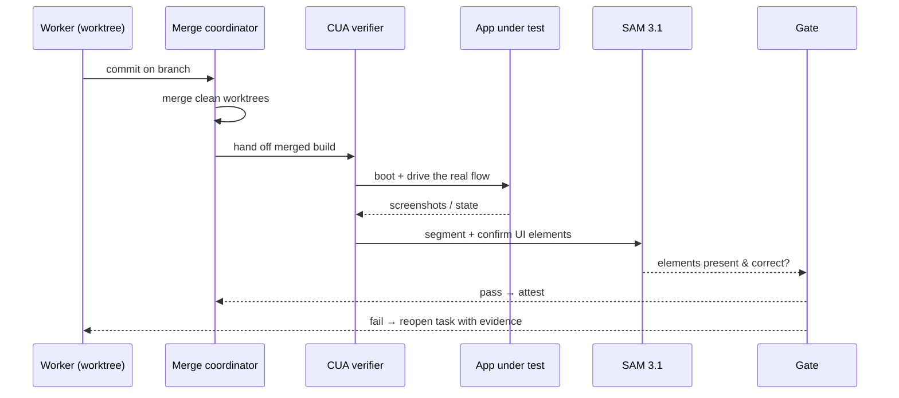

# Verification

> **Audience:** devs + judges · **Status:** draft · **Last updated:** 2026-10-27 · **Related:** [ARCHITECTURE](ARCHITECTURE.md) · [AGENT_DESIGN](AGENT_DESIGN.md)

> **Partly superseded:** the verification loop is now the Red/Green/Break proof with a blind verifier — see [ARCHITECTURE §1, §6–7](ARCHITECTURE.md). The rationale below still holds; the step list and diagram describe the earlier design.

This is the heart of Attest: **a passing unit test is not proof.** The agent may not declare a task done until a computer-use verifier has driven the running application and observed the expected behaviour.

## Why tests aren't enough

Frontier coding agents' generated tests catch **fewer than 55% of logical mutants** ([nielstron, 2026](https://x.com/nielstron/status/2109651666790445209)). In practice that means:

- Tests assert on internals, not on the behaviour the user asked for.
- Green CI hides a broken UI, a dead button, or a wrong redirect.
- The gap between "tests pass" and "it works" is exactly where agents ship bugs.

Attest closes that gap by verifying **at the level the user experiences** — the running app.

## The verification loop

### Steps

1. **Boot** the merged build in a clean environment.
2. **Drive** the exact user flow named in the plan (browser or desktop, via computer-use).
3. **Observe** — capture screenshots and any produced state.
4. **Confirm** — segment the UI with SAM 3.1 and check the required elements are present and correct.
5. **Gate** — pass, or reopen the task with the captured evidence attached.

## Pass / fail criteria

| Check | Passes when |
|---|---|
| Flow completes | The scripted steps reach the expected end state |
| Required elements | SAM 3.1 finds the expected UI regions |
| No regressions | Pre-existing verified flows still pass |
| Diff sanity | The merged diff matches the approved plan |

A task is **done** only when all checks pass. Anything else reopens the task.

## Test-time scaling

The verifier is a separate agent from the producer, and it is the same model family (producing agent + CUA verifying agent) — a form of test-time scaling that catches errors the producer can't see in its own work.

## What the verifier emits

For each verification: the driven steps, timestamps, screenshots, SAM segmentation results, and the pass/fail verdict — all appended to the event log and folded into the [attestation](EVENT_LOG_AND_REPLAY.md).

## See also

- [EVENT_LOG_AND_REPLAY](EVENT_LOG_AND_REPLAY.md) — how verdicts become evidence
- [MODEL_STRATEGY](MODEL_STRATEGY.md) — which model drives the verifier
